# Afterbell pitch deck

The business, and the path to $10M a year in fees. 13 slides.

Download: [afterbell-pitch-deck.pdf](pitch/afterbell-pitch-deck.pdf) (GitHub's PDF page has a download button).

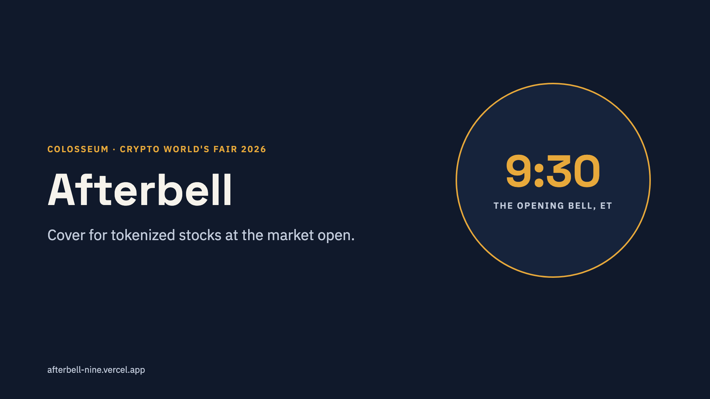

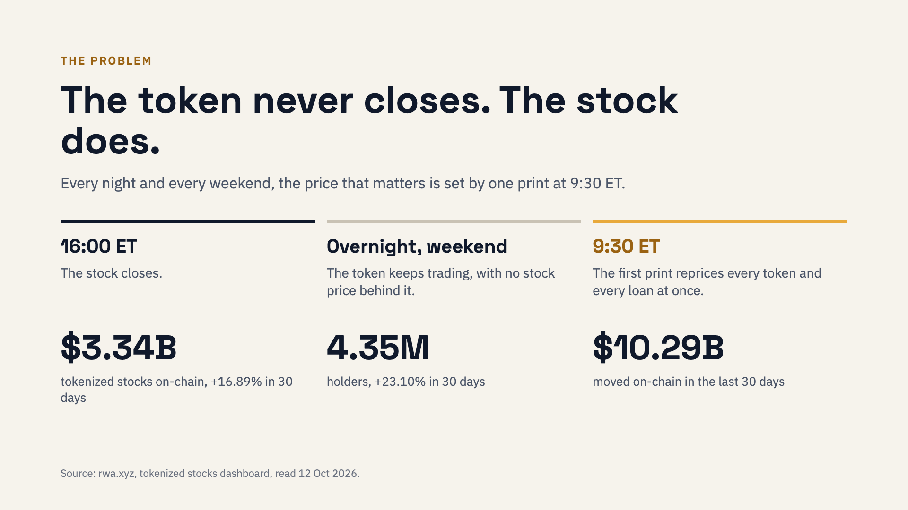

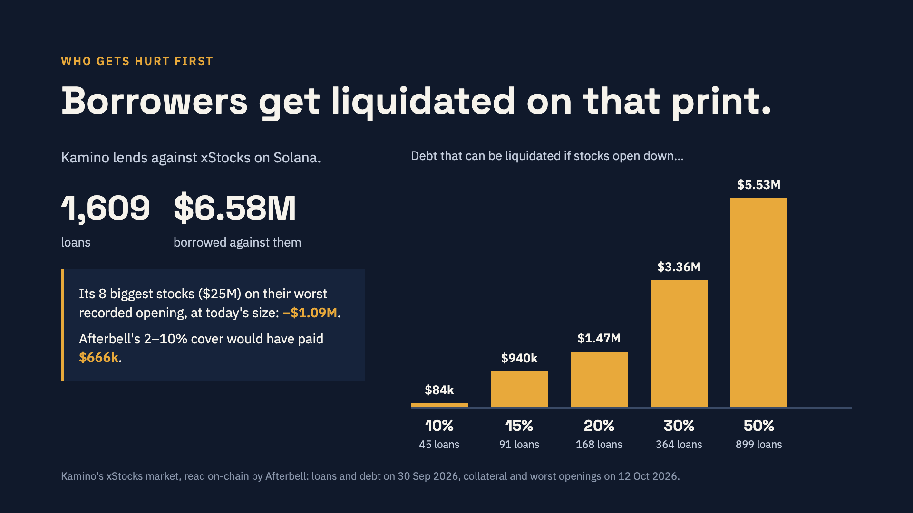

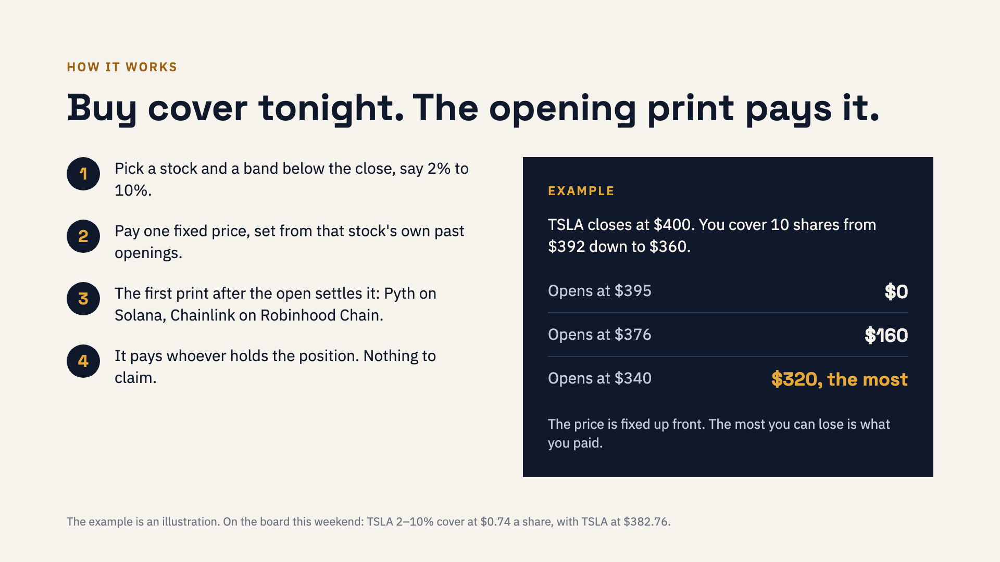

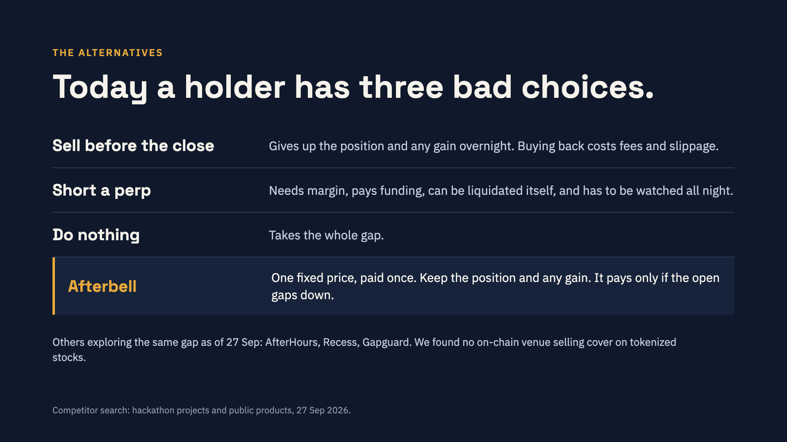

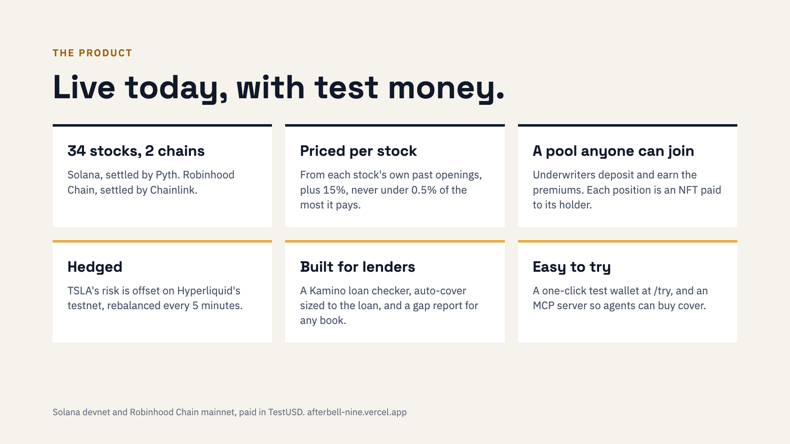

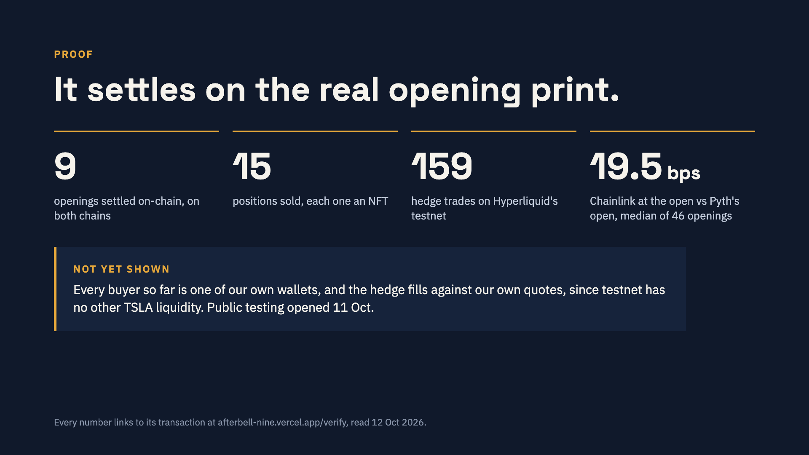

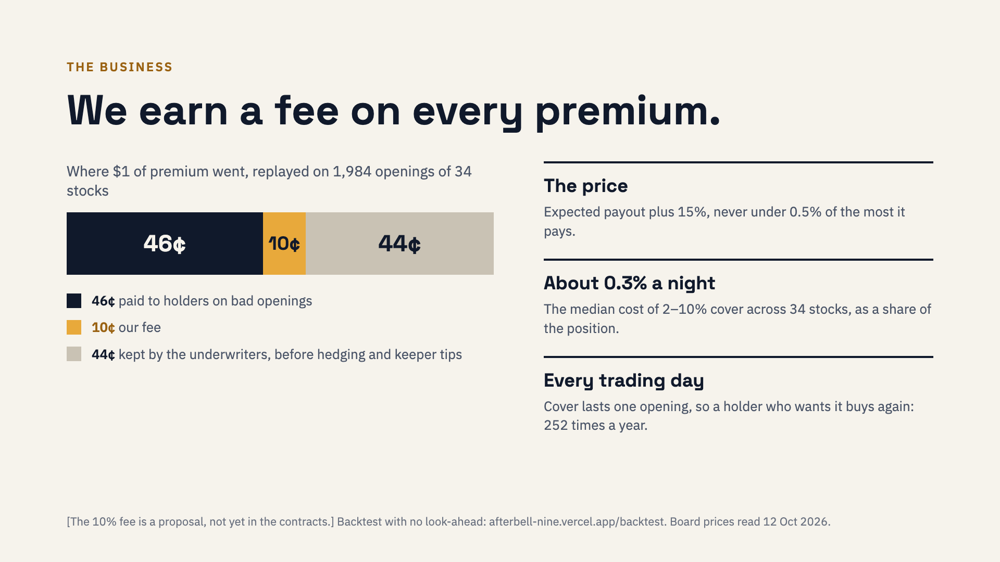

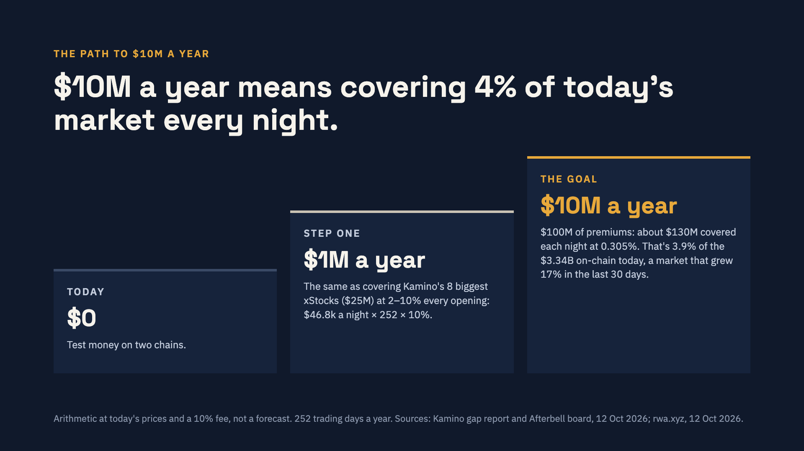

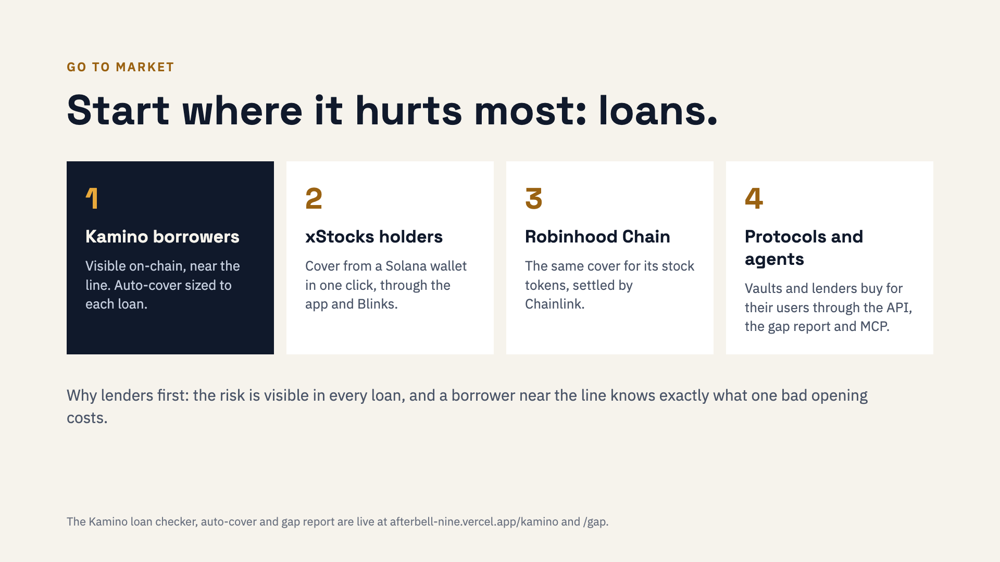

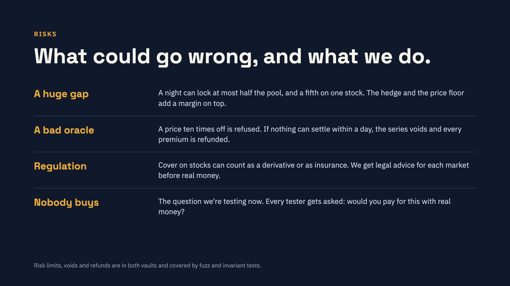

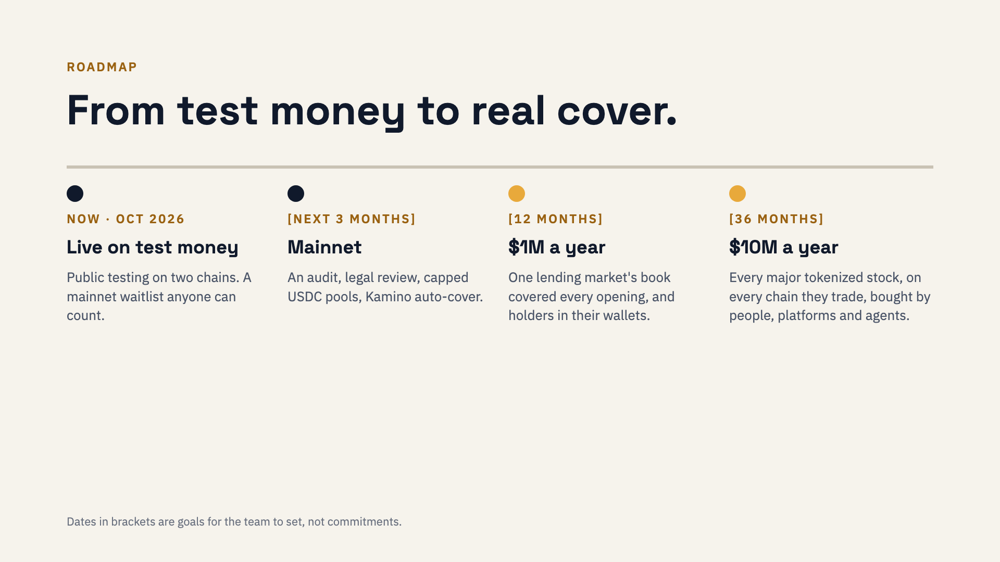

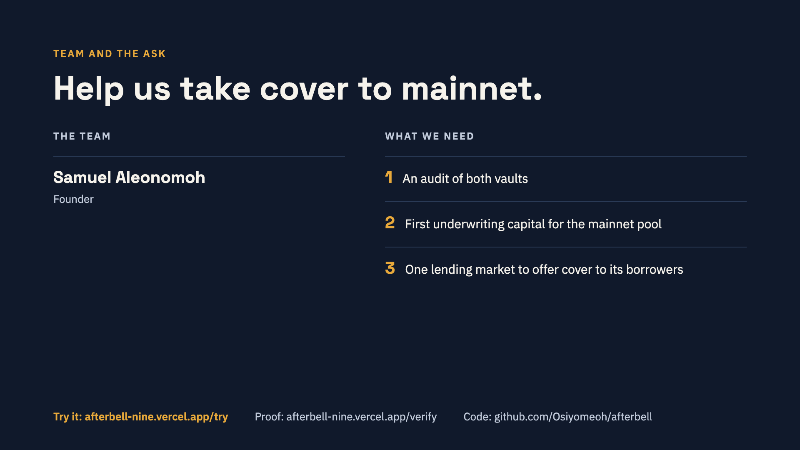
